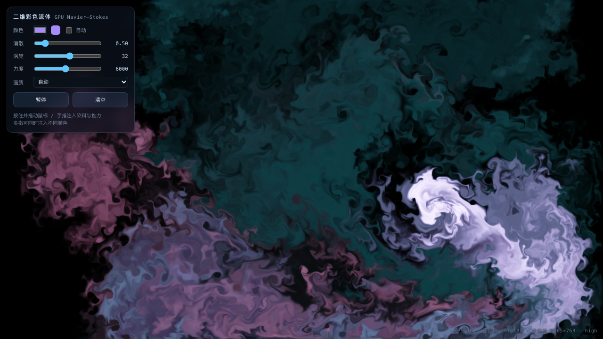

# ds41-fluid · 实时二维彩色流体

> 黑色画布上的实时 GPU 流体。按住并拖动鼠标（或手指），注入**染料**与**推力**，
> 形成连续卷曲、相互混合、逐渐消散的烟雾漩涡；在不同位置注入的颜色会在同一个
> 速度场里相遇、对流并互相混合。
>
> **单个 HTML 文件、原生 JavaScript + WebGL2、零依赖、零第三方流体库。**
> 求解的是网格上的不可压缩 Navier–Stokes 方程，**不是粒子尾迹冒充的烟雾**。



---

## 运行

**方式一：直接打开（最简单）**

```bash
open deepseek/ds41-fluid/index.html          # macOS
# 或在浏览器里直接打开这个文件（双击）
```

页面完全自包含：没有 ES Module、没有 `fetch`、没有任何外部资源，因此 `file://` 也能跑。

**方式二：本地静态服务器（可选）**

```bash
cd deepseek/ds41-fluid
python3 -m http.server 4173
# 打开 http://127.0.0.1:4173
```

**环境要求**

- 支持 **WebGL2** 的浏览器（Chrome / Edge / Firefox / Safari 15+）。
- 需要浮点渲染扩展 `EXT_color_buffer_float`（或 `EXT_color_buffer_half_float`）。
  桌面独显/核显基本都有；缺任何一个会在页面上给出明确提示。

---

## 交互

| 操作 | 效果 |
| --- | --- |
| **按住拖动鼠标** | 沿路径连续注入染料，并按拖动速度注入推力 → 拖出卷曲的烟雾 |
| **按住不动** | 持续注入染料（不产生推力），适合“点”出一个个色团 |
| **触摸拖动** | 与鼠标完全一致（Pointer Events + `touch-action:none`，不会滚动页面） |
| **多指同时拖动** | 每根手指是一个独立注入源，颜色不同，汇入同一个流场后互相混合 |
| **空格** | 暂停 / 继续 |
| **C** | 清空 |
| **A** | 切换自动配色 |

### 控件

| 控件 | 范围 | 说明 |
| --- | --- | --- |
| **颜色** | 取色器 + 自动 | 手动选一种注入色；“自动”让色相随时间缓慢循环，因此不同时刻/不同位置的笔触天然不同色 |
| **消散** | 0 – 4 /s | 染料场的指数衰减速率。0 = 几乎不散，4 = 几秒内散尽 |
| **涡旋** | 0 – 60 | 涡旋约束（vorticity confinement）强度。0 = 最平滑，越大细尺度卷曲越多 |
| **力度** | 800 – 12000 | 拖动时注入推力的大小 |
| **画质** | 自动 / 低 / 中 / 高 | 同时改变速度场网格、染料场网格与压力迭代次数；“自动”会按帧率升降档 |
| **暂停 / 清空** | — | 暂停只冻结物理，画面继续渲染；清空把染料、速度、压力全部归零 |

右下角 HUD 实时显示 FPS、速度场网格、染料场网格与当前画质档位。

---

## 实现要点

### 1. 求解的是什么

连续形式的不可压缩 Navier–Stokes 方程：

```
∂u/∂t = −(u·∇)u − ∇p + ν∇²u + f      动量方程
∇·u   = 0                            不可压缩约束
∂c/∂t = −(u·∇)c − κc + s             染料输运
```

`u` 是速度场，`p` 是压力，`c` 是染料（RGB），`f` 是鼠标注入的推力，`s` 是注入的染料，
`κ` 就是「消散」滑块。所有场都是**二维网格纹理**，不是粒子。

### 2. 每个物理步的 GPU 流水线

速度场与染料场都是 `RGBA16F` 浮点纹理，用 ping-pong FBO 读写。每一步按固定顺序执行：

| 步骤 | 着色器 | 作用 |
| --- | --- | --- |
| 1 | `advection` | 半拉格朗日平流速度场（回溯采样 + 双线性插值） |
| 2 | `advection` | 半拉格朗日平流染料场 |
| 3 | `curl` | 计算涡度 `ω = ∇×u` |
| 4 | `vorticity` | 涡旋约束：把数值耗散掉的细尺度涡量重新注入 |
| 5 | `divergence` | 计算散度 `∇·u`（边界做 Neumann 条件） |
| 6 | `clear` | 压力场乘 0.8 做衰减，抑制低频残差累积 |
| 7 | `pressure` | Jacobi 迭代求解泊松方程 `∇²p = ∇·u`（14/22/30 次，随画质） |
| 8 | `gradient` | `u ← u − ∇p`，得到近似无散速度场 |

注入（`splat`）在每帧物理步之前执行：一个高斯核分别加到速度场（推力）和染料场（颜色）上。
每帧最多跑 2 个固定步长的物理子步，多余的积压时间直接丢弃，避免低帧率下的“追帧雪崩”。

### 3. 为什么会有“卷曲”

- **半拉格朗日平流**本身会把染料拉成丝带，但数值耗散会抹掉小涡。
- **涡旋约束**（步骤 3–4）显式地把涡量补回去：从 `ω` 的梯度算出指向涡心的力，
  再按 `curl` 强度加回速度场。这正是「涡旋」滑块控制的东西。
- 速度场带极小的黏性耗散（`ν = 0.18`），保证长时间运行不会能量堆积。
- 涡旋约束后的速度被限幅到 ±1000，避免极端输入下出现数值爆炸。

### 4. 不同颜色为什么会互相混合

染料是**同一个 RGB 场的三个通道**，所有注入源都写进这张纹理。
平流的双线性插值天然把相邻颜色按比例混合，速度场把两团颜色卷到一起，
于是红 + 蓝会经过品红区过渡——这不是贴图叠加，是同一标量场被对流输运的结果。

### 5. 稳定性设计

- 固定物理步长 `1/60`，不同刷新率下行为一致；单帧最多 2 个子步。
- 标签页切回时的大时间跳变被截断到 0.1s，并丢弃积压时间。
- 衰减用 `1/(1+κ·dt)` 形式，对任意 `dt` 都不会出现负值或发散。
- 速度限幅、压力衰减、涡旋力归一化（`force / (|force| + 1e-4)`）共同防止 NaN。
- 画质自适应：启动 3.5s 宽限期后，帧率低于 42 降档、高于 57 持续 5s 升档；
  切换画质时用 `copy` 着色器把旧场重采样进新网格，染料不会丢。
- 窗口缩放时按新的纵横比重建网格（避免流体被拉伸），同样保留内容。

### 6. 渲染

染料场经 `display` 着色器上屏：四邻域微光 → filmic 滚降 `1 − e^{−1.7c}` →
暗角 → 亚像素抖动（消除 8bit 色带）。所以高浓度核心不会硬切成纯白，
低浓度处也不会出现台阶状色带。

---

## 目录

```
ds41-fluid/
├── index.html     全部实现（HTML + CSS + 原生 JS + WebGL2 着色器），单文件
├── verify.mjs     端到端验证脚本（agent-browser 驱动真实浏览器）
├── README.md
└── shots/         截图
```

---

## 验证

`verify.mjs` 通过 `agent-browser` 驱动**真实浏览器**做端到端验证：
真实鼠标拖动、合成 PointerEvent（触摸）、真实按钮与键盘，并用页面内探针
把浮点场降采样后 `readPixels` 做定量断言。

```bash
node verify.mjs
```

实测结果 **33 / 33 通过**（Headless Chrome + SwiftShader 软件渲染，1280×720，固定「中」画质）：

| 分组 | 项目 | 实测 |
| --- | --- | --- |
| 启动 | 求解器就绪 / 无运行时错误 | 速度场 228×128，染料场 910×512 |
| 清空 | 染料场归零、显示输出为黑 | lit=0，mean=[0,0,0] |
| 鼠标 | 拖动注入染料 | 4096 个探针像素中 868 个有色 |
| 鼠标 | 拖动注入推力 | 速度探针均值 0.101 |
| 显示 | 染料经显示着色器上屏 | 14400 个采样点中 3115 个有色 |
| 鼠标 | 连续多次拖动持续累积 | lit 868 → 1575 |
| 颜色 | 手动颜色控制 | 最大值 RGB=[1, 0, 0.28]（红主导） |
| 涡旋 | 水平注射后横向铺开 | 占据 8 行网格中的 4 → 8 行 |
| 涡旋 | 强度写入生效 | curl=40 |
| 混合 | 红/蓝两处颜色共存 | 红格 17、蓝格 18 |
| 混合 | **颜色相互混合（品红区）** | **混合格 19** |
| 暂停 | 按钮/API、时间冻结、场完全静止 | simTime 0.37 → 0.37，mass 完全相等 |
| 暂停 | 恢复后继续演化 | mass 0.0129 → 0.0084 |
| 消散 | 消散=0 基本保留 | mass 0.0210 → 0.0210 |
| 消散 | 消散=4 快速衰减 | mass 0.0096 → 0.0000 |
| 触摸 | 指针识别 + 拖动注入 | down=1 / up=0，lit=397 |
| 触摸 | 双指同时注入 | 同时指针=2，lit=850 |
| 键盘 | 空格暂停/恢复、C 清空 | 全部生效 |
| 缩放 | 网格跟随纵横比重建 | 228×128 → 169×128（canvas 1280×720 → 820×620） |
| 缩放 | 缩放后染料保留并继续演化 | lit=144 |
| 稳定 | 持续操作 12s 无错误无 NaN | minFps=11（软件渲染），峰值染料均值 0.169 |
| 稳定 | 染料未整体过曝、指针全部释放 | 保留颜色层次 |

> 软件渲染（SwiftShader）下「高」档只有约 22 fps，「中」档约 63 fps，「低」档约 84 fps；
> 带 GPU 的普通桌面浏览器中「中/高」档稳定 60 fps。

另外做过一次 **30s 极端压力测试**（涡旋=60、力度=12000、消散=0 三项同时拉满，
每轮 4 次随机大冲量注入 + 周期拖动）：

| 指标 | 实测 |
| --- | --- |
| 运行时错误 | 0 |
| 帧率 | 35 – 53 |
| 速度场峰值 | 始终封顶在 ±1000 限幅（探针量程 200 已饱和） |
| 染料均值 | 0 → 0.77 缓慢累积（消散=0，符合预期），无 NaN / Infinity |
| 物理时间 | 25.9s 连续推进，指针全部释放 |

即：**即使把三个参数同时拉到极端并持续涂抹，求解器仍然有界、不发散。**

截图见 `shots/`：`hero.png`（三色笔触）、`02-evolved.png`（2.5s 后演化）、`01-drag.png`（单笔卷曲）、`03-mobile.png`（390×844 窄屏 + 触摸注入）。

> 另外单独用 390×844 竖屏视口 + 合成 PointerEvent 验证过：面板自适应窄屏、触摸拖动正常注入、
> 网格按竖屏纵横比重建（速度场 128×277、染料场 512×1108），无运行时错误。

---

## 已知限制

1. **必须有 WebGL2 + 浮点渲染扩展**。没有 WebGL2 或没有
   `EXT_color_buffer_float` / `EXT_color_buffer_half_float` 时页面只显示提示，
   **没有 WebGL1 回退路径**。
2. **软件渲染很慢**。无 GPU 的环境（Headless Chrome + SwiftShader、远程桌面、
   没有显卡直通的虚拟机）里，自动画质会降到「低」档；此时物理仍稳定，
   但网格较粗、画面偏软。
3. **这是一个视觉上可信、物理上近似的求解器**，不是工程级 CFD：
   - 半拉格朗日平流有数值耗散，细节会随时间损失；
   - 压力用固定次数的 Jacobi 迭代，速度场只是近似无散，不是严格无散；
   - 染料按 RGB 相加混合，浓度很高时趋向白色（不是颜料式减色混合）；
   - 边界是封闭盒子（法向速度为零），没有入流/出流。
4. **分辨率有上限**。速度场最长边 ≤ 1400、染料场短边 96–768（随画质），
   画布像素数上限 260 万。因此在大窗口 / 高 DPI 下，染料场会被放大到全屏，
   有轻微柔化感。
5. **缩放会重采样内容**。窗口纵横比变化时网格重建，旧场被 `copy` 着色器
   重采样到新网格，会损失一点锐度（但不会清空）。
6. **极端参数下运动变快**。把「力度」和「涡旋」都拉到最大并持续涂抹时，
   速度会撞到 ±1000 的限幅，画面会偏快、偏抖——这是有界的，不会发散或出 NaN，
   但视觉上不如默认参数自然。
7. **FPS 是主线程估算**，不是 GPU 时间戳查询；后台标签页里的数值没有意义。
8. **上下文丢失会整页重载**。检测到 `webglcontextlost` 时保存状态过于复杂，
   这里直接重载页面恢复。
9. **自动化截图工具可能抓到黑帧**。未开启 `preserveDrawingBuffer`（为了性能），
   所以用外部工具在渲染帧之外读取画布可能得到空帧；系统级截图不受影响。
10. **触摸依赖 Pointer Events**。绝大多数现代浏览器都支持；非常老的浏览器
    可能只有 Touch Events，此时触摸拖动无效（鼠标仍可用）。
