# iPhone Duo 产品页 · 前端复刻

> 对 `https://www.apple.com.cn/iphone-duo/` 的高保真前端复刻。
> React + TypeScript + Vite，17 个章节全部实装，产品素材（图片 / 视频）全部本地化。
>
> 提示词：[完整版](../../prompts/iphone-duo.md) · [精简版](../../prompts/iphone-duo-short.md)（本实现用的是完整版）

---

## 效果

### 桌面 1440×900

| 首屏 | 先刷重点 |
| --- | --- |
| 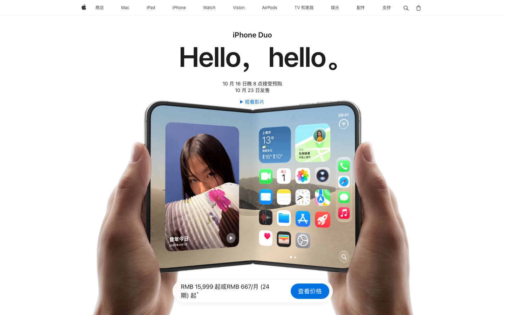 | 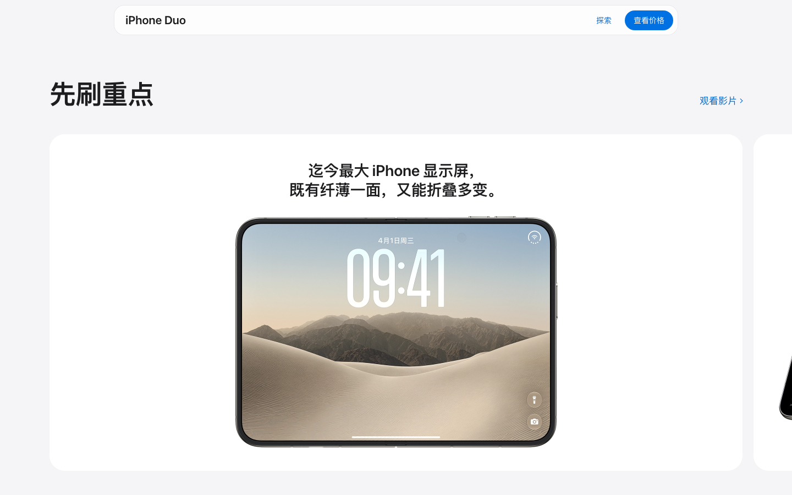 |

| 定睛细看（7 种姿态 + 折叠滑块） | 摄像头 |
| --- | --- |
| 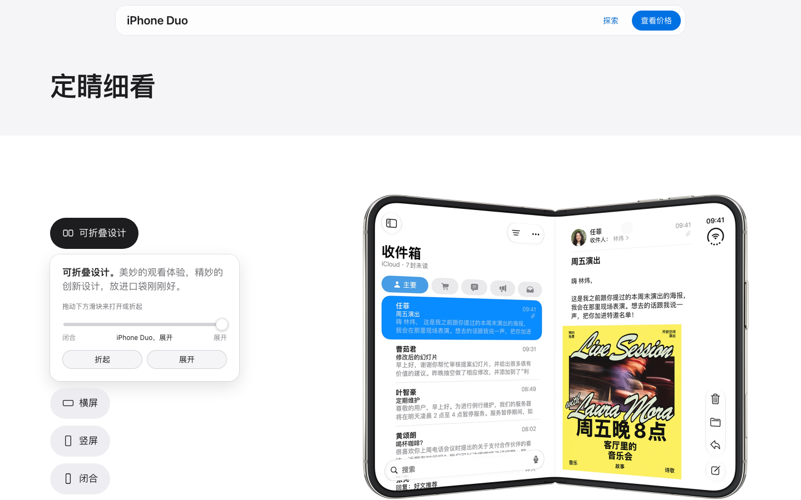 | 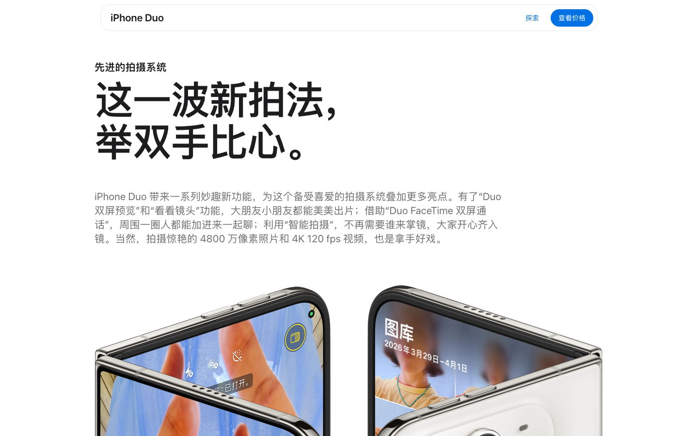 |

| 机型比较 | 常见问题 |
| --- | --- |
| 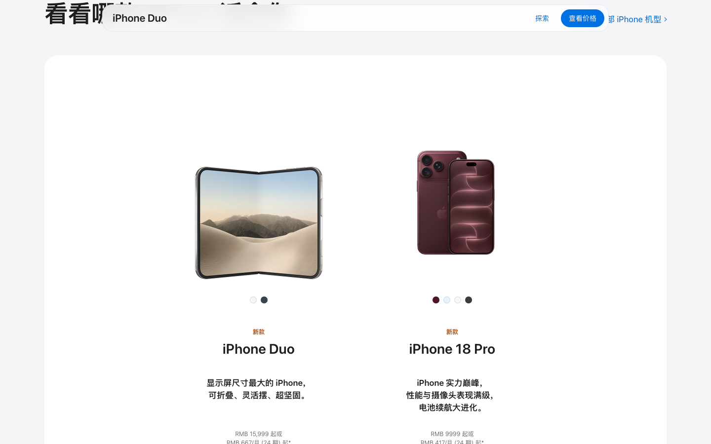 | 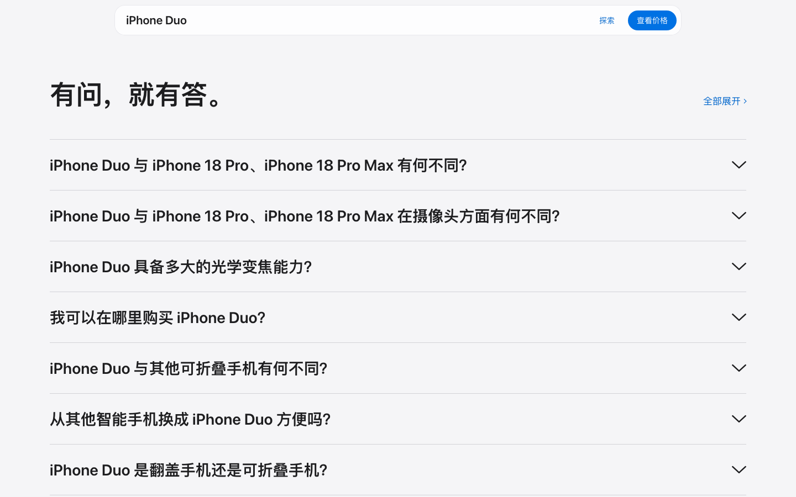 |

| 购买权益 | 共有功能 |
| --- | --- |
| 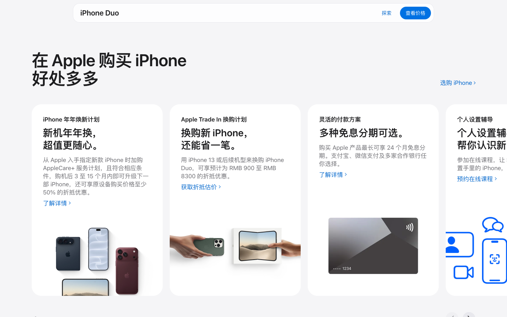 |  |

### 手机 390×844

| 首屏 | 定睛细看 | 机型比较 |
| --- | --- | --- |
|  | 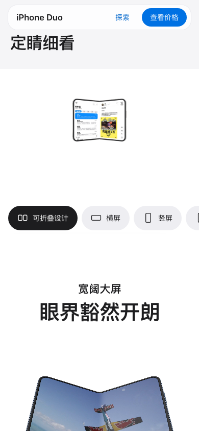 | 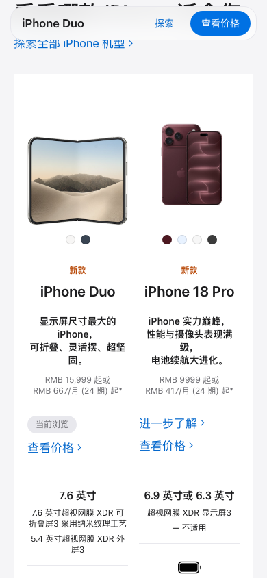 |

手机端是重新组织的布局，不是桌面版等比缩小：首屏主视觉改成比视口更宽的通栏裁切、
价格区变成通栏浅灰条、亮点卡片右侧露出下一张、产品查看器的控制列改为横向滚动、
机型比较并排两列且左右规格行用 `subgrid` 对齐。

### 与参考页面对照

| 参考页面 · 首屏 | 复刻 · 首屏 |
| --- | --- |
| 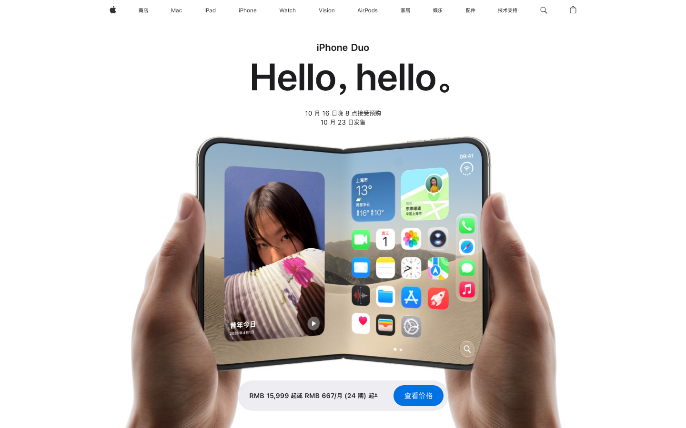 |  |

| 参考页面 · 机型比较 | 复刻 · 机型比较 |
| --- | --- |
| 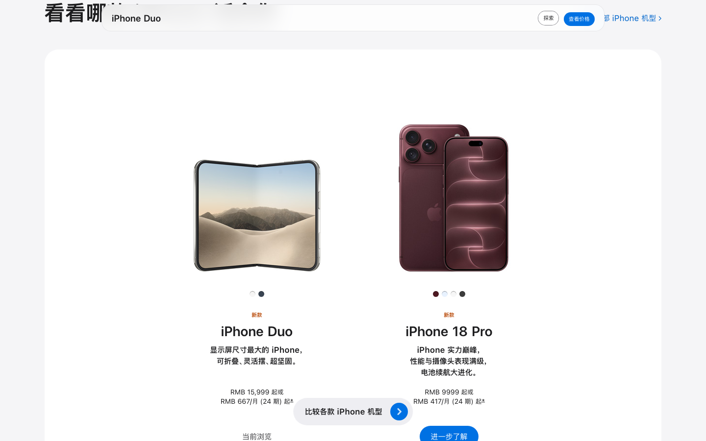 |  |

> 截图由 `verify.mjs` 同款浏览器（Chromium）实拍，桌面 1440×900、手机 390×844；
> `ref-*` 前缀是参考页面在相同宽度、相同滚动位置的截图。
> 首屏是一段从「闭合」到「展开」的官方动画（参考页面同样是 `loop=false`），两张截图都停在展开姿态。

---

## 运行

```bash
cd deepseek/ds41-iphone-duo
npm install
npm run dev          # → http://127.0.0.1:5186
```

生产构建与本地预览：

```bash
npm run build        # tsc -b && vite build → dist/
npm run preview      # 预览构建产物
npm run typecheck    # 只做类型检查
```

也可以走聚合服务（一个端口看所有 `ds41-*` 案例）：

```bash
cd deepseek
node serve-cases.mjs          # → http://127.0.0.1:5180/ds41-iphone-duo/
```

`serve-cases.mjs` 会以 `--base=/ds41-iphone-duo/` 拉起本案例的 Vite dev server 并做反向代理，
素材路径通过 `import.meta.env.BASE_URL` 适配，因此根路径和子路径都能正常加载。

---

## 页面结构

顺序与参考页面一致，共 17 个章节：

| # | 章节 | 组件 | 关键交互 |
| --- | --- | --- | --- |
| 1 | 全局导航 | `GlobalNav` | 搜索 / 购物袋弹层，小屏折叠菜单 |
| 2 | 悬浮产品导航 | `LocalNav` | 滚动后浮出，探索弹层含章节导航与机型列表 |
| 3 | 首屏 Hero | `Hero` | 主视觉动画视频（本地 mp4 + poster 兜底）、价格胶囊、影片弹层 |
| 4 | 先刷重点 | `Highlights` | 全宽卡片横向画廊（画面铺满卡片、说明句叠加其上）、前后翻页、触摸横滑、键盘方向键、自动播放启停 |
| 5 | 可折叠设计 | `Design` | 夜空色 / 星光白色配色切换（两张独立实拍图淡入淡出） |
| 6 | 定睛细看 | `ProductViewer` | 7 种姿态切换 + 可拖动折叠滑块（鼠标 / 触摸 / 键盘） |
| 7 | 宽阔大屏 | `Display` | 内屏动画视频、关键数字带 |
| 8 | 灵活多用 | `Versatility` | 姿态画廊轮播 |
| 9 | 先进的拍摄系统 | `Cameras` | 相机硬件图组 + 胶囊 tab 功能切换（各带官方动画视频）+ 九宫格功能画廊 |
| 10 | 性能与续航 | `Performance` | 机型比较选择器（15 款机型的真实对比数据） |
| 11 | 全系全配 | `SharedFeatures` | Apple 智能 + 连接功能三卡 |
| 12 | 配件 | `Accessories` | 配件图文 + 选购入口 |
| 13 | 购买权益 | `Incentives` | 7 张横向权益卡片，详情弹层 |
| 14 | 机型比较 | `CompareTable` | 一块白色面板里两块机型卡，用 CSS `subgrid` 让左右规格行横向对齐；小屏并排两列且不横向溢出 |
| 15 | 环境 | `EnvironmentAndValues` | 三个回收 / 能源数字 |
| 16 | 价值观 | `EnvironmentAndValues` | 环境 / 隐私 / 无障碍三卡 |
| 17 | FAQ + 页脚 | `Faq` / `Footer` | 单条展开、全部展开、全部收起，aria-expanded 与图标同步；页脚多列目录小屏可折叠 |

---

## 素材

参考页面用到的 99 张图片与 9 段视频已下载到 `public/assets/`（约 38 MB），
按章节分组存放，**未做拉伸、裁剪或调色**：

```
public/assets/
├── hero/          首屏主视觉图 + 首屏动画 mp4 + 起始 / 结束帧
├── highlights/    6 张亮点卡片素材 + 3 段官方动画 mp4
├── design/        夜空色 / 星光白色两张大图
├── viewer/        可折叠 / 横屏 / 竖屏 / 闭合 / 坐立 / 站立 / 耐用性 7 张
├── display/       内屏动画 mp4 + 起始帧 + 尺寸对比图
├── versatility/   待机显示 / 灵活观看 / FaceTime 三张场景图
├── camera/        相机硬件图 + 4 段功能动画 mp4 + 9 张功能画廊图
├── performance/   芯片主视觉 + 电池图标
├── shared/        Apple 智能、eSIM、车祸检测、查找
├── accessories/   保护壳与双面夹
├── incentive/     7 张权益卡片图 + 二维码
├── compare/       机型对比图与规格行图标
├── env/ values/   环保与价值观图标
└── localnav/      机型导航缩略图
```

每张图对应的原始 URL 记录在 `src/data/assets.ts` 的 `ASSET_SOURCES` 中，便于核对与替换。
素材版权归 Apple 所有，案例仅用于前端复刻与评测。

**没有下载的内容：** 完整产品影片 `iphone-duo-product-tpl-cn-2026_960x540.mp4` 有 40 MB，
未随仓库分发。影片弹层播放的是本地保存的官方首屏动画短片，并在弹层内给出原片公开地址。

---

## 实现要点

### 视觉变量
`src/styles/tokens.css` 是唯一的取值来源，桌面与手机两档都直接用参考页面的计算样式实测值：

| 项目 | 1440 桌面 | 390 手机 |
| --- | --- | --- |
| 首屏主标题 | 80 / 87px | 48 / 52.5px |
| 章节大标题 | 80 / 87px | 40 / 44px |
| 章节头标题 | 48 / 52px | 32 / 39px |
| 眉题 | 21 / 21px | 21 / 21px |
| 正文 | 17 / 25px | 17 / 25px |
| 次级文字 | 21 / 29px | 19 / 26px |
| 说明文字 | 12 / 16px | 12 / 16px |
| 内容宽度 / 栏距 | 1260 / 90px | 100% / 20px |

卡片圆角 28px、胶囊 980px。移动端按 1068px / 734px 两档断点**重新组织布局**，
而不是把桌面版等比缩小：首屏主视觉改为比视口更宽的通栏裁切、价格区改成通栏浅灰条、
亮点卡片 321px 宽并在右侧露出下一张、产品查看器的控制列改为横向滚动、
机型比较改成两列并排且整页不横向溢出。

### 布局还原
首屏按参考页面在 1440×900 下的实测几何还原：内容宽 1260 居中、主视觉 927×614
贴住首屏底部（实测 @x256 / y286，本页 @x257 / y286）、价格胶囊压在底部 36px 留白上；
全局导航 44px 且随页面滚走，滚动后由悬浮产品导航接管。
句号按参考页面的做法绝对定位在主标题右外侧，因此主标题文字本身仍然居中。
各章节的间距（128 / 144 / 224px）与网格列宽也来自同一批测量值。

### 动效
优先用 CSS + `IntersectionObserver` + `requestAnimationFrame`，没有引入 GSAP：

- `useRevealOnScroll`：进入视口时 30px 上移 + 淡入，同组元素依次延迟 70ms；
- `useScrollPast`：rAF 节流监听滚动，控制悬浮产品导航浮出；
- `useCarousel`：`scroll-snap` 横滑 + 按钮翻页 + 边界按钮禁用状态；
- `useActiveSection`：探索弹层里高亮当前章节；
- `prefers-reduced-motion: reduce` 时全部动效时长压到 1ms 并直接显示内容。

### 悬浮产品导航
滚动 620px 后浮出。几何取自参考页面实测：最大宽 1024px、高 53px、圆角 18px、
`top: 10px`、背景 `rgba(255,255,255,.8)` + 20px 模糊、1px `#e8e8ed` 描边；
左侧是产品名，右侧是探索入口与蓝色价格按钮，探索入口打开章节导航弹层。

### 折叠交互
`ProductViewer` 的第 1 项是原生 `<input type="range">`（因此天然支持鼠标、触摸和方向键），
进度 0→1 分三段落在**闭合 → 半开 → 展开**三张真实实拍图上，切换时做一次 380ms 的淡入。
另外 6 个姿态是独立的实拍图直接切换。

> 三帧是同一台机器的不同姿态，直接交叉淡化会出现「两张图叠在一起」的重影，
> 所以这里采用明确的分段切换，而不是把静态图横向拉伸或半透明叠加冒充折叠动画。

### 视频
`LazyVideo` 统一处理：poster 必填、`preload="none"`、`muted` + `playsInline`、
进入视口才播放、离开视口暂停、`onError` 时回退为 poster 静态图。
只有当前可见的章节才会下载视频，9 段视频不会一次性拉取。

首屏那段开合动画按参考页面的做法 **`loop=false`**：只播一次并停在展开的结束帧
（参考页面 `video` 元素的实测属性就是 `loop=false`、`data-inline-media-unload-at-end=true`），
所以页面稳定后画面始终是展开姿态。

### 无障碍
- 弹层用 `useFocusTrap`：打开时移入焦点、Tab 循环、Escape 关闭、关闭后焦点回到触发元素；
- FAQ 的 `aria-expanded` / `aria-controls` 与展开状态、chevron 图标（展开时旋转 180°）三者同步；
- 所有图标按钮都有可访问名称，滑块有 `aria-valuetext`；
- 轮播容器是 `tabIndex=0` 的 `role="group"`，支持左右方向键；
- 固定导航高度写进 `scroll-padding-top`，锚点标题不会被遮挡。

### 图片降级
`main.tsx` 里挂了全局 `error` 捕获，任何一张图加载失败都会加上 `.is-broken`（隐藏自身），
容器用 `:has(img.is-broken)` 在这种情况下才补上中性底色 —— 正常渲染时不会在 `contain`
的图片周围露出灰块，失败时也不会出现破图图标或永久加载状态，版面始终完整。

---

## 目录

```
ds41-iphone-duo/
├── index.html
├── vite.config.ts / tsconfig*.json / package.json
├── PROMPT.md                 本轮实际使用的提示词（原样保留）
├── PROMPT-short.md           精简版提示词，可直接分享给读者
├── verify.mjs                端到端验收脚本（agent-browser 驱动）
├── shots/                    实测截图（含参考页面对照图）
├── public/assets/            本地化的产品图片与视频
└── src/
    ├── main.tsx              入口 + 图片失败兜底
    ├── App.tsx               章节装配
    ├── styles/
    │   ├── tokens.css        设计变量
    │   └── global.css        重置、工具类、动效基类
    ├── data/                 参数、轮播内容、FAQ、资源地址
    │   ├── assets.ts         素材表 + 原始来源
    │   ├── product.ts        产品名、价格、日期、导航
    │   ├── highlights.ts / design.ts / viewer.ts / display.ts
    │   ├── versatility.ts / cameras.ts / performance.ts
    │   ├── shared.ts / accessories.ts / incentives.ts / compare.ts
    │   └── faq.ts            16 条常见问题
    ├── hooks/                滚动、轮播、焦点、减弱动效
    └── components/           17 个章节组件 + common/ 通用件
```

---

## 验证

`verify.mjs` 用 agent-browser 驱动真实 Chromium，覆盖三档宽度的布局检查与全部核心交互：

```bash
npm run dev            # 另一个终端先起服务
node verify.mjs        # 默认 http://127.0.0.1:5186
```

实测 **26 / 26 通过**：

| 项目 | 实测 |
| --- | --- |
| 1440×900 / 1024×768 / 390×844 无横向溢出 | 三档均为 `overflowX=0px` |
| 参考页面关键几何对齐 | 首屏主视觉 927×614 @x256、价格胶囊位置、章节间距与参考页面一致 |
| 三档宽度无破图、标题不越界 | 0 张失败、0 个标题被截断 |
| 17 个章节全部存在 | 14 个锚点章节 + 首屏 / 导航 / 页脚 |
| 首屏主视觉可见、主标题 80px、按钮 `#0071e3` | 主视觉宽 927px，与参考页面一致 |
| 配色切换 | 选中星光白色后只剩 1 张激活图（`design-star-white.webp`） |
| 产品姿态切换 | 选「闭合」后舞台图为 `closed.webp` |
| 折叠滑块 | 拖到 0 显示 `closed.webp`（闭合），拖到 1 显示 `foldable.webp`（展开），`aria-valuetext` 同步 |
| 滑块是真实 range 控件 | `min=0 max=1 step=0.01`（键盘方向键可用） |
| 摄像头功能切换 | 选「看看镜头」后只有 1 个 panel 可见 |
| 机型比较选择器 | 切到 iPhone 17 后 4 项数据与对比说明同步更新 |
| FAQ | 单条展开 2 项；全部展开 16 项；全部收起 0 项；图标与 `aria-expanded` 一致 |
| 价格弹层 | 打开正常，Escape 关闭并恢复焦点 |
| 亮点画廊翻页 | `scrollLeft` 0 → 1280，上一页按钮由禁用变为可用 |
| 页面运行时错误 | 无 |

生产构建 `npm run build`（`tsc -b && vite build`）通过。

`shots/` 目录保存了桌面与手机两种宽度的实测截图，`ref-*` 前缀的是参考页面同位置截图，便于对照。

---

## 已知限制

- **完整产品影片未本地化。** 原片 40 MB，未随仓库分发，影片弹层播放的是官方首屏动画短片。
- **首屏是动画而非静止画面。** 首屏是一段从「闭合」到「展开」的官方动画，
  播放一次后停在展开姿态；静态 poster 用的也是动画结束帧，因此首帧与播放结束后都呈现展开的双手持握画面。
- **技术规格页未实现。** 探索弹层里保留了入口占位并标注「未包含在本复刻中」，没有编造规格表。
- **3D 序列被静态帧替代。** 参考页面的产品查看器由 3D 模型 / 帧序列驱动，本复刻用同一组真实产品图的
  分段切换代替，没有伪造中间帧，也没有把两张不同姿态叠加成重影。
- **搜索与购物袋是本地演示弹层**，不发起真实请求；价格按钮打开说明弹层并给出 apple.com.cn 的真实入口。
- **机型比较只放了 iPhone Duo 与 iPhone 18 Pro 两款**（与参考页面首屏可见的两张卡片一致），
  其余机型通过「探索全部 iPhone 机型」外链跳转。
- 手机的独立裁切素材（`*-sm.*`）只覆盖了首屏、亮点卡片、设计、产品查看器、显示屏、
  灵活多用与摄像头硬件图；其余位置在手机上沿用桌面素材等比缩放。
- 首屏与各章节的排版数值取自 1440×900 与 390×844 两档实测，中间宽度（如 1024）为断点内插，未逐像素核对。
- 机型比较的左右规格行对齐依赖 CSS `subgrid`；不支持 subgrid 的旧浏览器会退回普通网格，
  两列行高各自独立（内容与排版仍然正确，只是行不互相对齐）。
- 本案例是学习与评测用的复刻演示，与 Apple 无关联，也未获得 Apple 的授权或认可。

---

## 来源与许可

- 页面文案、产品图片、产品视频：均来自 `https://www.apple.com.cn/iphone-duo/` 的公开资源，版权归 Apple 所有。
- 素材清单与逐个原始 URL：见 `src/data/assets.ts`。
- 代码：本仓库 MIT 许可证。
