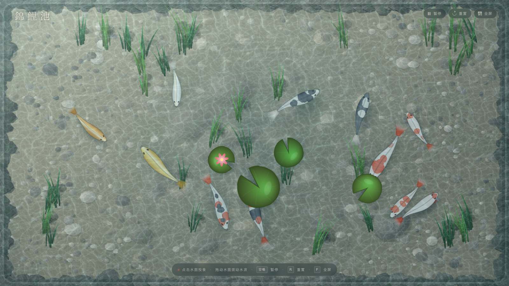

# 锦鲤池 · Koi Pond

> 一个可交互的日式锦鲤池网页。俯视清澈池水 —— 鹅卵石、水草、睡莲、水面波纹与阳光折射的光斑；
> 11 条程序化锦鲤自然游动，身体弯曲带动尾巴摆动。
> **全部场景与鱼体均由代码绘制，不依赖任何外部图片、视频或字体文件。**



---

## 运行

零依赖，只需要 Node（≥ 18）：

```bash
cd deepseek/ds41-koi-pond
node server.mjs          # 或 npm start
```

然后打开 **http://127.0.0.1:4173**

> 页面使用 ES Modules，必须通过 HTTP 打开（`file://` 会被浏览器拦截）。
> 也可以换成任意静态服务器，例如 `python3 -m http.server 4173`。

指定端口：`node server.mjs 8080`。

---

## 交互

| 操作 | 效果 |
| --- | --- |
| **单击水面** | 投放一小簇鱼食，溅起同心涟漪；附近的鱼转向、加速聚拢，吃完后散开 |
| **按住拖动** | 拨动水面，产生有方向的尾波与折射扭曲，沿途留下细涟漪 |
| **暂停 / 继续** | 顶部按钮或 <kbd>空格</kbd> |
| **重置** | 顶部按钮或 <kbd>R</kbd> —— 清空鱼食、复原鱼群与水面 |
| **全屏** | 顶部按钮或 <kbd>F</kbd> |
| <kbd>D</kbd> | 显示/隐藏调试 HUD（帧率、鱼群状态、分辨率） |

鼠标静止数秒后界面自动淡出，只留画面本身。

---

## 实现要点

### 1. 水面 —— 二维波动方程 + 折射 + 焦散
`src/water.js`

- **高度场**：在约 224×126 的网格上用显式差分求解二维波动方程
  `h' = h + (h − h_prev)·damp + k·∇²h`，带速度阻尼、幅度泄漏与 ±1.5 限幅，
  保证连续投食/拖动时不会因低频驻波堆积而发散。
- **折射**：把平滑后的高度场梯度当作位移场，将整个场景按 48px 网格分块重绘
  （相邻块重叠 1px 避免缝隙），得到随水波摆动的折射。
- **焦散**：`−∇²h` 给出波峰处的光线汇聚，配合法线做 Blinn-Phong 高光，
  写入一张低分辨率光照缓冲，再以 `lighter` 叠加。
- **光网贴片**：四族波动正弦的零交叉脊线交织成无缝可平铺的焦散图案
  （整数谐波保证接缝），两层不同尺度缓慢漂移，叠在池底、鱼身之下。
- **水面反光**：一层更慢、更横向拉伸的光膜 + 顶部天光渐变，暗示水面朝向光源。

### 2. 锦鲤 —— 行波脊线 + 体坐标系花纹
`src/koi.js`

- **身体**：从吻端向尾部逐段积分曲率，`bend(s) = A·sin(2π(s·k − φ))·ramp(s)`，
  `ramp` 让头部稳定、尾部摆幅最大 —— 即“弯曲带动尾巴”。相位随速度推进，
  游得越快尾摆频率越高；尾鳍、胸鳍、背脊高光、眼睛都跟随脊线切线摆动。
- **花纹**：红斑 / 墨斑定义在 `(s,t)` 体坐标系内（s 沿脊线，t 横跨体宽），
  经脊线法线映射到世界坐标，因此会随身体弯曲而自然变形；再裁剪到体轮廓内。
- **品种**：红白（Kohaku）、丹顶（Tancho）、三色（Sanke）、昭和三色（Showa）、
  黄金（Ogon）、山吹黄金（Yamabuki）、白金（Platinum）、别甲（Bekko）、
  白写（Shiro Utsuri）—— 共 11 条，尺寸与花纹各不相同。
- **行为**：巡游（平滑一维噪声漫游）→ 进食（感知半径内锁定最近鱼食，
  转向加速，咀嚼冷却后进食）→ 饱足散开（朝远离投食点方向游走）。
  另有边界排斥、个体分离与轻微同向倾向；深度随状态变化，进食时上浮。

### 3. 池底 —— 一次性离屏渲染
`src/pond.js`

沙床、1200+ 枚不规则鹅卵石（线性渐变单一光源方向）、带裂纹苔痕的大石头、
环形石岸、苔藓斑、细沙颗粒；再叠加**景深**：中心深水区柔化、近岸锐利，
形成清澈水体的纵深。水草与睡莲每帧重绘以产生摆动，睡莲为不规则外形。

### 4. 渲染管线
`src/main.js`

```
离屏场景层  floor → 水草 → 睡莲投影 → 焦散光网 → 锦鲤 → 悬浮微粒
   ↓ 折射扭曲（分块位移）
主画布      水色叠加 → 水面高光/动态焦散 → 涟漪 → 水面反光膜 → 睡莲 → 鱼食
```

- 水面物理固定 1/60 步长推进，渲染跟随显示器刷新率。
- **自适应画质**：启动 2.5s 后开始统计帧率，偏低时逐级降低渲染分辨率
  （1.0 → 0.82 → 0.68）与折射网格密度；帧率恢复后自动回升。
- 视网膜屏最高按 devicePixelRatio=2 渲染，并限制总像素数。

---

## 目录

```
ds41-koi-pond/
├── index.html        页面骨架与 UI
├── styles.css        界面样式（毛玻璃面板 / 衬线标题）
├── server.mjs        零依赖静态服务器
├── verify.mjs        端到端功能验证脚本（agent-browser 驱动）
├── package.json
└── src/
    ├── main.js       装配、交互、渲染循环、自适应画质
    ├── pond.js       池底、鹅卵石、石岸、水草、睡莲
    ├── water.js      波动方程、折射、焦散、光网贴图
    ├── koi.js        程序化锦鲤（脊线行波 + 体坐标花纹 + AI）
    ├── food.js       鱼食颗粒
    └── util.js       数学与绘图辅助
```

---

## 验证

`verify.mjs` 通过 `agent-browser` 驱动真实浏览器（真实鼠标事件、真实按钮点击），
覆盖交互与状态机的完整链路：

```bash
node verify.mjs
```

实测结果 **24 / 24 通过**：

| 项目 | 结果 |
| --- | --- |
| 页面无运行时错误 | ✅ |
| 锦鲤数量 ≥ 8（实测 11） | ✅ |
| 连续 6 次投食生成鱼食（fed=34） | ✅ |
| 鱼群进入进食状态（11/11） | ✅ |
| 点击产生涟漪（ripples=15） | ✅ |
| 鱼群向投食点聚拢（平均距离 240.6 → 175.9 px） | ✅ |
| 鱼食被吃掉 | ✅ |
| 身体弯曲（脊线横向偏移 ≈13.8 px） | ✅ |
| 尾部随摆动位移（0.32s 内 32.2 px） | ✅ |
| 吃完后散开（平均距离 175.9 → 211.4 px） | ✅ |
| 暂停按钮 / 时间冻结 / 恢复 | ✅ |
| 重置清空鱼食与计数、鱼群复位、计时归零 | ✅ |
| 重置后可再次投食 | ✅ |
| 空格暂停 / R 重置 | ✅ |
| 窗口缩放后仍正常 | ✅ |
| 全程无运行时错误 | ✅ |

截图见 `shots/`（`01-initial` … `06-reset` 为完整场景，`crop-*` 为局部特写）。

> 注：`verify.mjs` 依赖本机已安装 `agent-browser`（`npm i -g agent-browser`）与 Chrome。
> 仅用于自动化回归，运行页面本身不需要它。

---

## 性能

无 GPU 的软件渲染环境（Headless Chrome / SwiftShader，1600×900）实测约 18 fps，
自适应画质会降到 0.68 倍分辨率并回升到约 35 fps；
在带 GPU 的普通桌面浏览器中稳定 60 fps。
